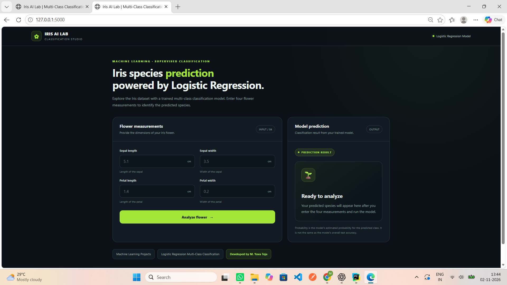
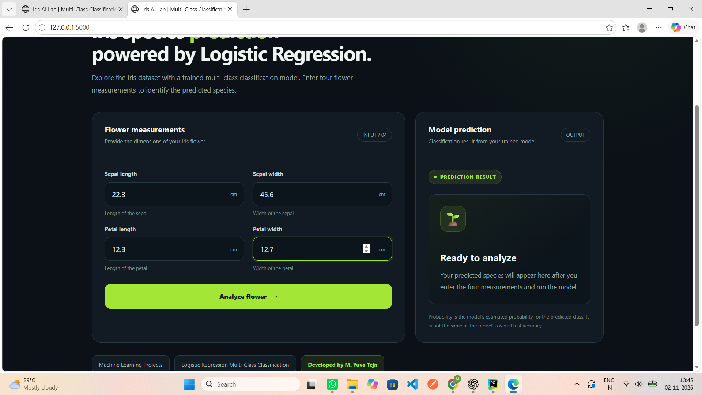
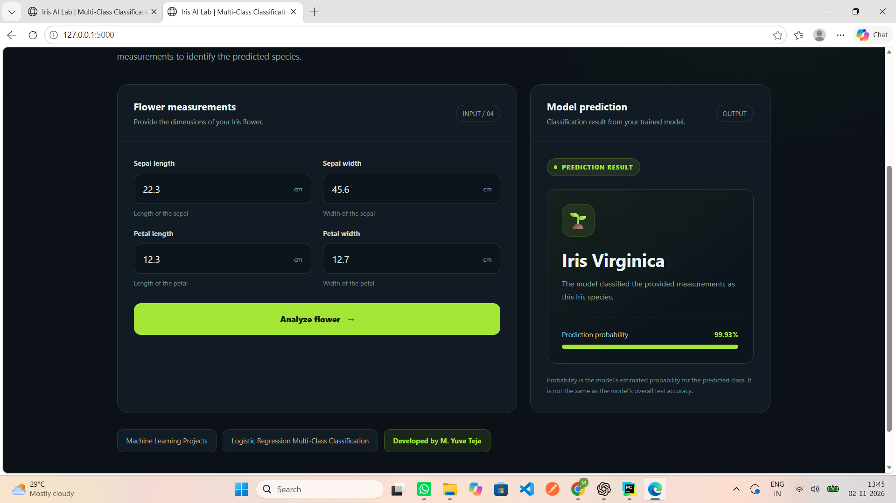
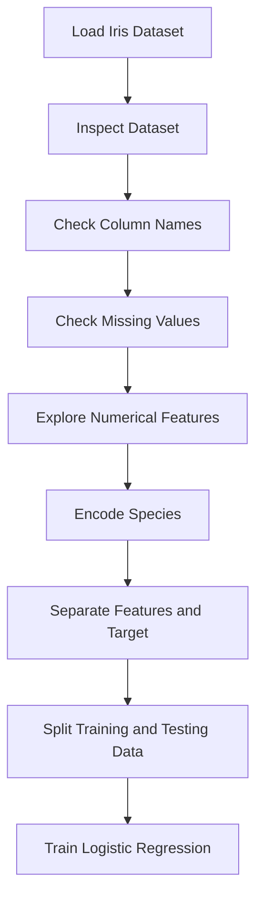
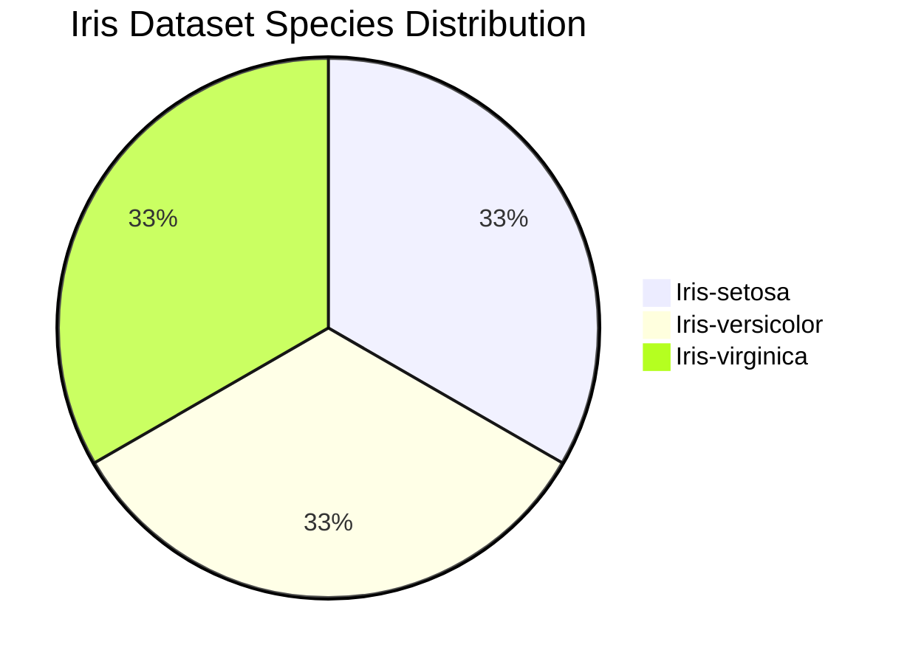
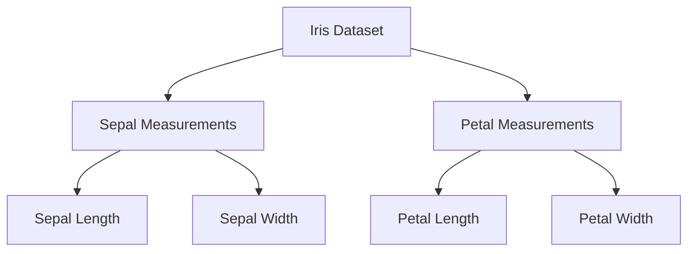
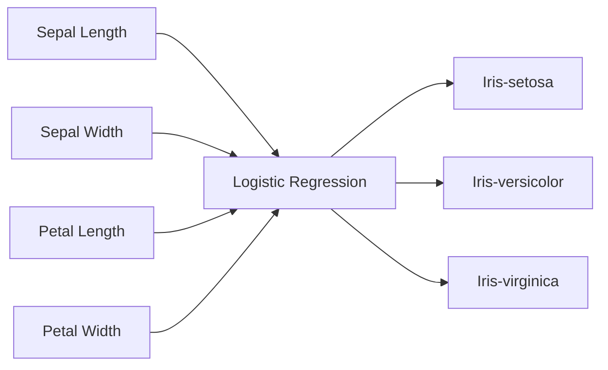
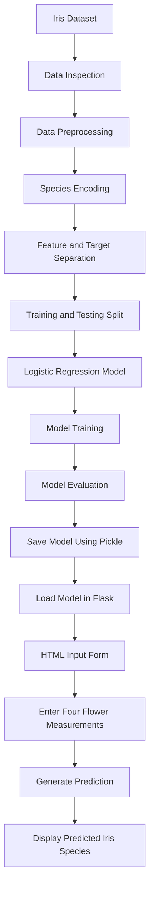
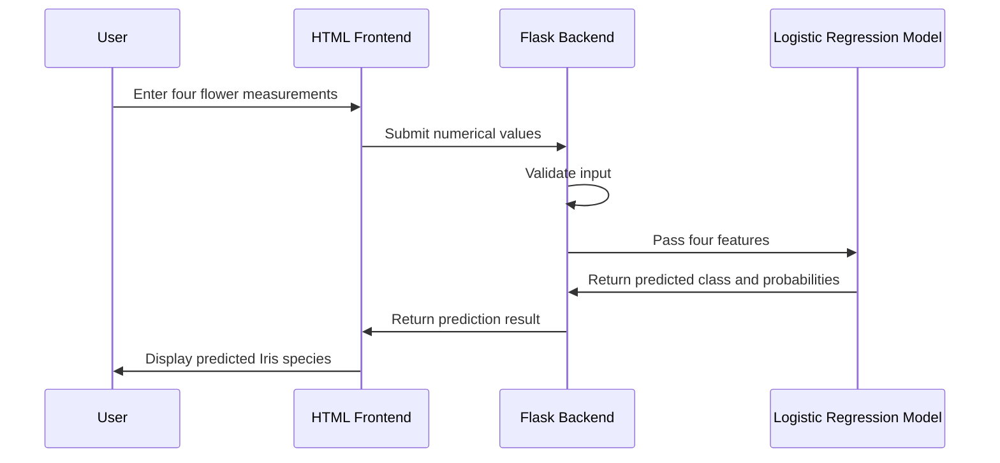

# 🌸 Logistic Regression Multi-Class Classification Using Iris Dataset

### A Machine Learning Multi-Class Classification Project

---

## 📌 Project Overview

This project demonstrates the implementation of a **Logistic Regression Machine Learning algorithm** for multi-class classification using the Iris Dataset.

The project predicts the species of an Iris flower based on four numerical measurements:

* Sepal Length
* Sepal Width
* Petal Length
* Petal Width

The trained Logistic Regression model classifies the flower into one of three Iris species:

* Iris-setosa
* Iris-versicolor
* Iris-virginica

The project includes:

* Machine Learning model development using Python.
* Object-Oriented Programming (OOP) implementation.
* Data preprocessing and target encoding.
* Model training and testing.
* Model evaluation using classification metrics.
* Model serialization using Pickle.
* Flask-based web application.
* Interactive HTML frontend.
* Four flower measurement input fields.
* Real-time model-based predictions.
* Prediction probability display.
* Random numerical value generation for testing.

The application accepts four numerical flower measurements from the user and passes them to a trained Logistic Regression model. The model predicts the Iris species and returns the result to the frontend.

This project is developed for educational purposes to understand the complete Machine Learning workflow, from dataset preprocessing and model training to web application development.

---

## 🎯 Project Objectives

The main objectives of this project are:

1. Understand the Logistic Regression algorithm.
2. Implement multi-class classification using Scikit-learn.
3. Perform data preprocessing and target encoding.
4. Train and evaluate a Machine Learning model.
5. Save and load a trained model using Pickle.
6. Develop a web application using Flask.
7. Connect a Machine Learning model with an HTML frontend.
8. Accept user input through a web interface.
9. Generate predictions using a trained model.
10. Understand the complete Machine Learning development workflow.

---

## 📸 Application Screenshots

The following screenshots demonstrate the working application. These images are stored in the `output_Screenshots` folder and are displayed directly in this README.

### 1. Application Homepage

The homepage introduces the Iris AI Lab application and displays the project interface. The dark-themed design provides a clean and organized layout for interacting with the trained Machine Learning model.

<p align="center">
  
</p>

<p align="center">
  <em>Figure 1: Iris classification application homepage.</em>
</p>

### 2. Flower Measurement Input Form

The application provides four numerical input fields for entering the flower measurements:

* Sepal Length (cm)
* Sepal Width (cm)
* Petal Length (cm)
* Petal Width (cm)

Users can enter measurements manually or use the random values feature to populate the fields for testing.

<p align="center">
  
</p>

<p align="center">
  <em>Figure 2: Input form for the four Iris flower measurements.</em>
</p>

### 3. Model Prediction Result

After submitting the flower measurements, the Flask backend passes the values to the trained Logistic Regression model.

The application displays the predicted Iris species and the estimated probability associated with the predicted class.

<p align="center">
  
</p>

<p align="center">
  <em>Figure 3: Model prediction result showing the predicted Iris species and probability.</em>
</p>

**Note:** These screenshots demonstrate the application interface and example predictions. The displayed probability is the model's estimated probability for the predicted class; it is not the same as the model's overall test accuracy.

---

## 🧠 Machine Learning Algorithm

### Logistic Regression

Logistic Regression is a supervised Machine Learning algorithm commonly used for classification problems.

Although its name contains the word regression, it is primarily used to predict the probability that an observation belongs to a particular class.

In this project, Logistic Regression is used to classify Iris flowers into three different species based on their measurements.

### Multi-Class Classification

Multi-class classification is a classification problem in which a model predicts one class from more than two possible classes.

The Iris dataset contains three species:

| Species         | Encoded Value |
| --------------- | ------------: |
| Iris-setosa     |             0 |
| Iris-versicolor |             1 |
| Iris-virginica  |             2 |

The model learns the relationship between the four flower measurement features and the target species.

### Logistic Regression for Multi-Class Classification

For multi-class classification, Logistic Regression estimates the probability of each possible class.

The model calculates a score for each class using the input features. The scores are converted into probabilities using the Softmax function:

$$
P(y=k \mid x)=\frac{e^{z_k}}{\sum_{j=1}^{K}e^{z_j}}
$$

Where:

* \(P(y=k \mid x)\) is the probability of the input belonging to class \(k\).
* \(z_k\) is the score calculated for class \(k\).
* \(K\) is the total number of classes.

In this project, \(K=3\).

The model selects the class with the highest predicted probability.

---

## 📊 Dataset Information

### Iris Dataset

This project uses the Iris Dataset, a well-known dataset commonly used for Machine Learning classification tasks.

The dataset contains measurements of Iris flowers belonging to three different species. Each observation represents one Iris flower.

| Attribute          | Description                |
| ------------------ | -------------------------- |
| Dataset            | Iris Dataset               |
| Problem Type       | Multi-Class Classification |
| Target Variable    | `species`                  |
| Input Features     | 4                          |
| Number of Classes  | 3                          |
| Total Observations | 150                        |
| Algorithm          | Logistic Regression        |
| Library            | Scikit-learn               |

### Dataset Features

The dataset contains four numerical features.

#### 1. Sepal Length

The length of the sepal of the Iris flower, measured in centimeters.

#### 2. Sepal Width

The width of the sepal of the Iris flower, measured in centimeters.

#### 3. Petal Length

The length of the petal of the Iris flower, measured in centimeters.

#### 4. Petal Width

The width of the petal of the Iris flower, measured in centimeters.

### Target Variable

The target variable is `species`. It contains the name of the Iris flower species.

The text values are converted into numerical values before training the model.

```python
df["species"] = df["species"].map({
    "Iris-setosa": 0,
    "Iris-versicolor": 1,
    "Iris-virginica": 2
}).astype(int)
```

This encoding allows the classification algorithm to process the target variable numerically.

---

## 🔍 Exploratory Data Analysis (EDA)

Exploratory Data Analysis is performed to understand the structure, characteristics, and quality of the dataset before training the model.

EDA helps identify:

* Dataset structure.
* Number of observations and features.
* Data types.
* Missing values.
* Statistical distribution of numerical features.
* Relationships between flower measurements.
* Differences between Iris species.

### EDA Workflow



### 1. Dataset Inspection

The dataset is loaded using Pandas.

```python
import pandas as pd

df = pd.read_csv("IRIS - IRIS.csv")

print(df.head())

print(df.shape)

print(df.info())

print(df.describe())
```

This helps us understand:

* Dataset structure.
* Number of observations.
* Number of features.
* Data types.
* Statistical distribution of numerical columns.

### 2. Checking Dataset Columns

The dataset column names can be inspected using:

```python
column_names = df.columns

print(column_names)
```

The four independent features are the sepal length, sepal width, petal length, and petal width measurements.

The dependent column is `species`.

### 3. Checking Missing Values

Missing values can be checked using:

```python
print(df.isnull().sum())
```

This helps identify whether any dataset columns contain missing values.

### 4. Species Encoding

The species column contains text values. These values are converted into numerical values.

```python
df["species"] = df["species"].map({
    "Iris-setosa": 0,
    "Iris-versicolor": 1,
    "Iris-virginica": 2
}).astype(int)
```

### 5. Feature and Target Separation

The independent variables are stored in `X`.

The dependent variable is stored in `y`.

```python
X = df.iloc[:, :-1]

y = df.iloc[:, -1]
```

The input features contain the four flower measurements. The target variable contains the encoded species values.

### 6. Training and Testing Data

The dataset is divided into training and testing datasets.

```python
from sklearn.model_selection import train_test_split

x_train, x_test, y_train, y_test = train_test_split(
    X,
    y,
    test_size=0.2,
    random_state=42
)
```

The training dataset is used to train the model.

The testing dataset is used to evaluate its performance on unseen observations.

With 150 observations and a test size of 0.2, the split produces 120 training observations and 30 testing observations.

---

## 📊 EDA Diagrams

The following diagrams provide a visual overview of the Iris dataset.

### 1. Iris Species Distribution

The standard Iris dataset contains 50 observations for each of the three species.



### 2. Iris Dataset Feature Overview



### 3. Feature and Target Relationship



---

## ⚙️ Machine Learning Workflow

The complete Machine Learning workflow is represented below.



### Workflow Explanation

1. Load the Iris dataset.
2. Inspect the dataset structure.
3. Check the dataset for missing values.
4. Convert species values into numerical values.
5. Separate input features and target variable.
6. Split the dataset into training and testing data.
7. Create the Logistic Regression model.
8. Train the model using the training dataset.
9. Evaluate model performance.
10. Save the trained model using Pickle.
11. Load the model into the Flask application.
12. Accept four numerical flower measurements from the user.
13. Generate the prediction.
14. Display the predicted Iris species and probability.

---

## 📈 Model Evaluation

The Logistic Regression model is evaluated using the following metrics.

### 1. Confusion Matrix

A confusion matrix compares the actual classifications with the predicted classifications.

For this project, the class order is:

| Encoded Value | Species         |
| ------------: | --------------- |
|             0 | Iris-setosa     |
|             1 | Iris-versicolor |
|             2 | Iris-virginica  |

The confusion matrix contains three rows and three columns because the model predicts three different classes.

The diagonal values represent correctly classified observations. The off-diagonal values represent observations classified into an incorrect species.

### 2. Accuracy Score

Accuracy measures the percentage of correctly classified observations.

$$
Accuracy=\frac{Correct\ Predictions}{Total\ Predictions}
$$

Python implementation:

```python
from sklearn.metrics import accuracy_score

accuracy = accuracy_score(
    y_test,
    test_predict
)

print(accuracy)
```

### 3. Classification Report

The classification report provides:

* Precision
* Recall
* F1-score
* Support

```python
from sklearn.metrics import classification_report

print(
    classification_report(
        y_test,
        test_predict
    )
)
```

These metrics help evaluate the performance of the trained model for each Iris species.

**Note:** Actual performance values depend on the dataset, preprocessing, model configuration, and train-test split. No fixed accuracy value is assumed in this README.

---

## 💾 Model Serialization Using Pickle

After training, the Logistic Regression model is saved using Pickle.

```python
import pickle

with open(
    "Logistic_Regression_Multi_Label_Classification_Iris.pkl",
    "wb"
) as f:
    pickle.dump(reg, f)
```

The saved model can be loaded later.

```python
with open(
    "Logistic_Regression_Multi_Label_Classification_Iris.pkl",
    "rb"
) as p:
    model = pickle.load(p)
```

This allows the Flask application to use the trained model without training it again whenever the application starts.

### Important

Pickle files should only be loaded from trusted sources because loading an untrusted Pickle file can execute arbitrary code.

---

## 🌐 Flask Web Application

The project includes a Flask web application that connects the trained Machine Learning model with an HTML frontend.

### Frontend

The frontend is developed using:

* HTML
* CSS
* JavaScript

The application uses a modern dark-themed interface designed for an Iris flower classification system.

The frontend provides four input fields for flower measurements and a prediction section to display the model output.

### Backend

The backend is developed using Flask.

The Flask application performs the following operations:

1. Loads the trained Logistic Regression model.
2. Displays the HTML input form.
3. Receives numerical values from the frontend.
4. Validates the input values.
5. Converts the input into the required numerical format.
6. Passes the four measurements to the trained model.
7. Generates the classification prediction.
8. Calculates the estimated probability for the predicted class.
9. Returns the prediction result to the frontend.

### Prediction Process



---

## 🖥️ Application Features

### 1. Interactive Input Form

The application provides four numerical input fields:

* Sepal Length
* Sepal Width
* Petal Length
* Petal Width

Users can enter flower measurement values manually.

### 2. Random Values Generation

The Random Values button generates numerical values and fills the input fields.

This feature is useful for testing the frontend and backend integration.

**Important:** Randomly generated values are only for demonstration and testing. They do not represent actual flower measurements.

### 3. Prediction Generation

The Analyze Flower button submits the numerical input values to the Flask backend.

The trained Logistic Regression model generates the classification result.

### 4. Prediction Result

The application displays the predicted Iris species:

* Iris-setosa
* Iris-versicolor
* Iris-virginica

### 5. Prediction Probability

The application displays the estimated probability associated with the predicted class.

This probability represents the model's estimated probability for the selected class. It is not the same as the model's overall test accuracy.

### 6. Reset Values

The reset functionality allows users to clear the input fields and enter new flower measurements.

---

## 📁 Project Structure

The project repository is organized as follows:

```text
Logistic_Regression_Multi_Label_Classification/
│
├── .venv/
│
├── output_Screenshots/
│   ├── frontend_Ui.png
│   ├── inputs_design.png
│   └── prediction_design.png
│
├── templates/
│   └── index.html
│
├── app.py
│
├── main.py
│
├── Logistic_Regression_Multi_Label_Classification_Explanation.py
│
├── IRIS - IRIS.csv
│
├── Logistic_Regression_Multi_Label_Classification_Iris.pkl
│
├── requirements.txt
│
├── Procfile
│
└── README.md
```

### File Descriptions

| File                                                            | Description                                               |
| --------------------------------------------------------------- | --------------------------------------------------------- |
| `app.py`                                                        | Flask backend for the web application                     |
| `main.py`                                                       | Logistic Regression implementation using the Iris dataset |
| `Logistic_Regression_Multi_Label_Classification_Explanation.py` | Development and algorithm explanation code                |
| `index.html`                                                    | Frontend interface                                        |
| `IRIS - IRIS.csv`                                               | Iris dataset used for training and testing                |
| `Logistic_Regression_Multi_Label_Classification_Iris.pkl`       | Serialized Logistic Regression model                      |
| `requirements.txt`                                              | Python dependencies                                       |
| `Procfile`                                                      | Deployment start command, if used by the hosting platform |
| `output_Screenshots/`                                           | Application screenshots                                   |
| `README.md`                                                     | Project documentation                                     |

**Note:** The `.venv/` folder is a local virtual environment and generally should not be uploaded to GitHub.

---

## 🚀 Installation and Setup

Follow these steps to run the project locally.

### Step 1: Clone the Repository

```bash
git clone YOUR_GITHUB_REPOSITORY_URL
```

Replace `YOUR_GITHUB_REPOSITORY_URL` with your actual GitHub repository URL.

### Step 2: Navigate to the Project Folder

```bash
cd Logistic_Regression_Multi_Label_Classification
```

### Step 3: Create a Virtual Environment

```bash
python -m venv .venv
```

### Step 4: Activate the Virtual Environment

For Windows PowerShell:

```powershell
.\.venv\Scripts\Activate.ps1
```

For Windows Command Prompt:

```cmd
.venv\Scripts\activate
```

### Step 5: Install Dependencies

```bash
pip install -r requirements.txt
```

### Step 6: Run the Flask Application

```bash
python app.py
```

### Step 7: Open the Application

Open your browser and navigate to:

```text
http://127.0.0.1:5000
```

The application will display the Iris Classification interface.

---

## 🛠️ Technologies Used

| Technology   | Purpose                                  |
| ------------ | ---------------------------------------- |
| Python       | Programming language                     |
| Pandas       | Data preprocessing                       |
| NumPy        | Numerical operations                     |
| Scikit-learn | Logistic Regression and model evaluation |
| Flask        | Web application backend                  |
| HTML         | Frontend structure                       |
| CSS          | Frontend styling                         |
| JavaScript   | Interactive frontend functionality       |
| Pickle       | Model serialization                      |
| Git          | Version control                          |
| GitHub       | Project repository                       |

---

## 🔮 Future Improvements

The following improvements can be considered in future versions:

* Add more exploratory data analysis visualizations.
* Add feature distribution charts.
* Add a feature correlation heatmap.
* Compare Logistic Regression with other classification algorithms.
* Add cross-validation.
* Improve model evaluation and validation.
* Add automated input validation.
* Add unit testing for the Flask application.
* Improve the user interface and accessibility.
* Deploy the application to a cloud platform.
* Add model versioning and reproducibility.

---

## 👨‍💻 Developer

**Developed by M. Yuva Teja**

Machine Learning Project

Algorithm: Logistic Regression

Problem Type: Multi-Class Classification

Dataset: Iris Dataset

Application: Iris Flower Species Prediction

---

## ⚠️ Disclaimer

This project is developed for educational and demonstration purposes only.

The predictions generated by this application are based on a Machine Learning model and should be considered educational estimates.

The model's prediction probability is not a guarantee that a flower belongs to a particular species.

This application is intended to demonstrate the integration of a Machine Learning model with a web application.

---

## ⭐ Support

If you find this project useful for learning Machine Learning, Python, Flask, or Logistic Regression, consider giving the repository a star on GitHub.

Thank you for visiting this project!
